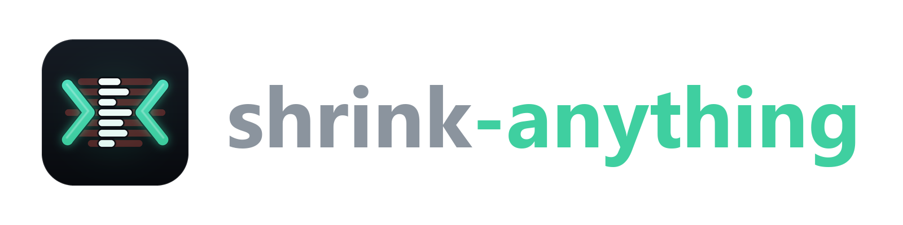
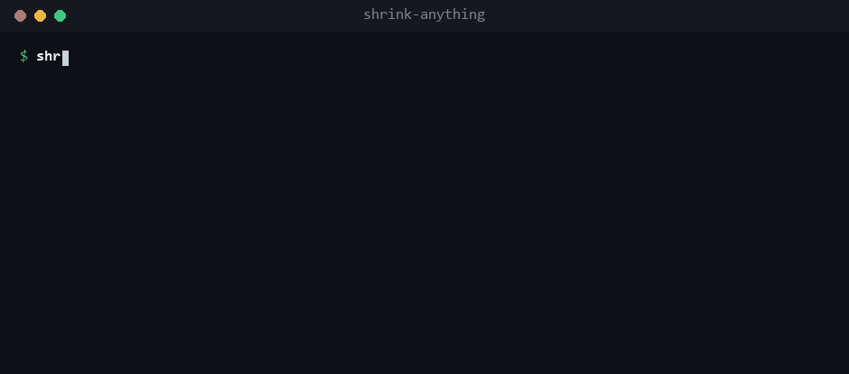

<p align="center">
  
</p>

<p align="center"><b>Less code. Same tests passing.</b></p>

<p align="center">
  <a href="https://www.npmjs.com/package/@el4cteo/shrink-anything"></a>
  <a href="https://crates.io/crates/shrink-anything"></a>
  <a href="https://github.com/EL4CTEO/shrink-anything/actions/workflows/ci.yml"></a>
  
  
  
  <a href="LICENSE"></a>
</p>

Coding agents write code faster than anyone deletes it. Functions nothing calls, files nothing imports, packages nothing uses, images nothing shows: your agent reads all of it, your CI builds it, your users download it.

**shrink-anything** finds it, deletes it, and runs *your own tests* after every cut. What passes stays. What breaks is put back. One command, fully reversible.

Every line it removes is a line your agent stops reading on the next task. The report counts that too: on the demo app, 46% fewer tokens to read.

<p align="center"></p>

## Install

```sh
npm i -g @el4cteo/shrink-anything      # or: cargo install shrink-anything
```

## Use

```sh
shrink-anything go --agent claude -- npm test     # or: -- pytest / cargo test / go test ./... / anything that fails when your app is broken
```

Or step by step:

| command | what it does |
|---|---|
| `scan` | lists what could go. Changes nothing |
| `cut -- <check>` | deletes what's dead and runs your check: what passes stays, what breaks is put back |
| `task --agent claude` | hands the judgment calls (duplicates, public methods) to your agent, and keeps its work only if the check agrees |
| `weigh dist` | where the weight of a build is: by kind of file, the heaviest files, what's in there twice |
| `verify` | runs your check now, against the test count from before the first cut |
| `undo` | takes the last cut back, byte for byte (`--all` for every cut) |
| `report` | markdown + SVG card for your PR |
| `doctor` | what's installed: parsers, package managers, agents |

`--agent` takes `claude`, `codex`, or any command that reads a prompt on stdin. Without it, hand `.shrink/TASK.md` to whatever you use.

## Proof, not vibes

<p align="center"></p>

Nothing in that code mentions `secretly_used`: a test reaches it through a name it reads from a data file. The cut broke that test, so it was put back, alone.

- **Your check decides.** A cut stays only if your command exits 0 *and* at least as many tests run as before. A check that already fails is refused: it can't prove anything.
- **One bad cut doesn't sink the rest.** Cuts go in as a batch. If the check fails, the batch is split until the one cut that breaks it is found and put back. Every state left on disk has passed.
- **Parsed before it's tested.** Each edited file goes through the language's own parser (Python, Node, Ruby, PHP, Lua, Bash) before your check runs.
- **Tests are never touched**, and `shrink-anything undo` restores every file byte for byte.
- **What can't be proven isn't cut.** A public method, an export of a library, a subclass a framework may register, a file in a folder loaded by convention: these go to your agent with the reason, or behind `--aggressive`.

The proof is as strong as your check. A project with no tests gets a scan, not a cut you should trust.

<p align="center"></p>

## What it finds

| | how it decides | where |
|---|---|---|
| **dead code** | every mention of the name is inside its own definition. Any other mention anywhere (another file, a string, a template, a config) keeps it | 19 languages |
| **dead files** | no other file names it | Python, JS/TS, PHP, Ruby, Dart, Lua/Luau |
| **unused dependencies** | nothing imports it or runs its commands | npm · pnpm · yarn · bun · Cargo · pip · Go modules |
| **dead weight** | an image, font or sound no code, config or README names; the same file stored twice | any project |
| **duplicates** | the same code twice, whatever it's called and however it's laid out | 19 languages, merged by your agent |

It counts names instead of building a call graph. A count can only miss dead code, never invent it, and it works the same in every language.

## Results

The demo projects in [`examples/`](examples), each with planted dead code. Run them yourself.

| project | before | after |
|---|---|---|
| TypeScript cart | 106 lines, 5 files, 3 dependencies | **58 lines, 3 files, 1 dependency** (−45%) |
| Python shop | 142 lines, 8 files | **86 lines, 7 files** (−39%) |
| Go store | 89 lines | **55 lines** (−38%) |
| Static site (build output) | 913 KB | **398 KB** (−56%) |

On real projects expect less per run and more over time: the safe cuts go on their own, the rest is a reviewed list.

## Lighter builds

```sh
shrink-anything weigh dist                                   # where the weight is
shrink-anything cut --size dist -- "npm run build && npm test"   # cut, rebuild, weigh again
```

`--size` takes a build folder or a binary and reports it before and after. Fewer dependencies and less code mean a smaller bundle; unused assets are cut like dead code. Assets in a folder served as it is (`public/`, `static/`) need `--aggressive`: a page outside your repo may link to them.

## Agents

- **Claude Code plugin**: `/plugin marketplace add EL4CTEO/shrink-anything`, then `/plugin install shrink-anything@shrink-anything` and `/shrink-anything:shrink npm test`
- **MCP server** (Claude Code, Codex, Cursor…), built into the binary: `claude mcp add shrink-anything -- shrink-anything mcp`. 8 tools: `shrink_scan`, `shrink_cut`, `shrink_task`, `shrink_verify`, `shrink_undo`, `shrink_report`, `shrink_weigh`, `shrink_status`.
- **Skill**: [`skills/shrink-anything`](skills/shrink-anything/SKILL.md) teaches any agent the loop.

## Languages

Dead code and duplicates: Python · JavaScript · TypeScript · Rust · Go · Java · Kotlin · C# · C · C++ · PHP · Ruby · Swift · Dart · Lua · Luau · Elixir · Shell.
Every other text file (HTML, Vue, Svelte, YAML, SQL, templates…) is read for mentions, so a function used only from a template stays.

A language is one entry in a table ([`src/lang.rs`](src/lang.rs)): how its comments and strings look, how a block ends, what a definition looks like. Adding one is a pull request of about twenty lines.

## Library or app?

In a library, public names belong to its users, so they're kept. shrink-anything guesses per language (a published `package.json`, a `lib.rs`, no `package main`) and says what it guessed. Override with `--lib` or `--app`.

## License

MIT
