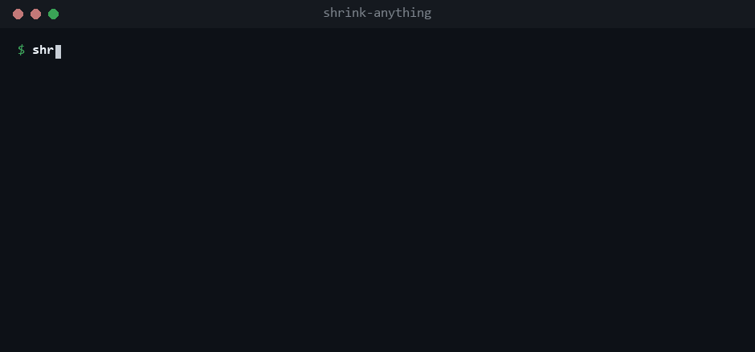
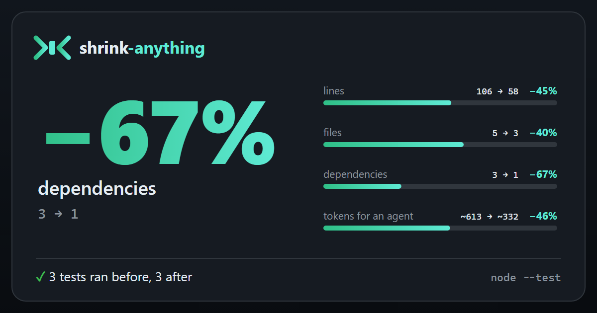

<p align="center">
  
</p>

<p align="center"><b>Less code. Same tests passing.</b></p>

<p align="center">
  <a href="https://www.npmjs.com/package/@el4cteo/shrink-anything"></a>
  <a href="https://crates.io/crates/shrink-anything"></a>
  <a href="https://github.com/EL4CTEO/shrink-anything/actions/workflows/ci.yml"></a>
  <a href="LICENSE"></a>
</p>

**shrink-anything** finds dead code, files, dependencies and assets, deletes them, and runs *your own tests* after every cut. What passes stays, what breaks is put back. Fully reversible.

Less code also means less for your agent to read: on the demo app, 46% fewer tokens.

<p align="center"></p>

## Install

```sh
npm i -g @el4cteo/shrink-anything      # or: cargo install shrink-anything
```

## Use

```sh
shrink-anything go --agent claude -- npm test     # or pytest, cargo test, go test ./..., any check that fails when the app breaks
```

Or step by step:

| command | what it does |
|---|---|
| `scan` | lists what could go, changes nothing |
| `cut -- <check>` | deletes what's dead, runs your check, puts back what breaks |
| `task --agent claude` | hands judgment calls (duplicates, public methods) to your agent; keeps its work only if the check passes |
| `weigh dist` | where a build's weight is: by file kind, heaviest files, duplicates |
| `verify` | runs your check against the test count from before the first cut |
| `undo` | restores the last cut byte for byte (`--all` for every cut) |
| `report` | markdown + SVG card for your PR |
| `status` · `doctor` | current state · installed parsers, package managers, agents |

`--agent` takes `claude`, `codex`, or any command that reads a prompt on stdin. Without it, hand `.shrink/TASK.md` to any agent.

## How it stays safe

<p align="center"></p>

- **Your check decides.** A cut stays only if the check exits 0 *and* at least as many tests run as before. A check that already fails is refused.
- **Bad cuts are isolated.** Cuts go in batches; a failing batch is split until the one breaking cut is found and put back.
- **Parsed first.** Edited files go through the language's own parser (Python, Node, Ruby, PHP, Lua, Bash) before your check runs.
- **Tests are never touched**, and `undo` restores every file byte for byte.
- **Unprovable cuts are skipped.** Public methods, library exports, framework-registered classes and convention-loaded files go to your agent, or need `--aggressive`.

No tests means a scan, not a cut you should trust.

## What it finds

| | rule | where |
|---|---|---|
| **dead code** | every mention of the name is inside its own definition | 18 languages |
| **dead files** | no other file names it | Python, JS/TS, PHP, Ruby, Dart, Lua/Luau |
| **unused dependencies** | nothing imports it or runs its commands | npm, pnpm, yarn, bun, Cargo, pip, Go modules |
| **dead weight** | images, fonts, sounds nothing names; files stored twice | any project |
| **duplicates** | the same code twice, however it's named or laid out | 18 languages, merged by your agent |

It counts names instead of building a call graph, so it can miss dead code but never invent it.

Languages: Python, JavaScript, TypeScript, Rust, Go, Java, Kotlin, C#, C, C++, PHP, Ruby, Swift, Dart, Lua, Luau, Elixir, Shell. Other text files (HTML, Vue, Svelte, YAML, SQL, templates) are read for mentions. Adding a language is ~20 lines in [`src/lang.rs`](src/lang.rs).

Libraries keep their public names. The mode is guessed per language and printed; override with `--lib` or `--app`.

## Results

Demo projects in [`examples/`](examples), with planted dead code:

| project | before | after |
|---|---|---|
| TypeScript cart | 106 lines, 5 files, 3 deps | **58 lines, 3 files, 1 dep** (−45%) |
| Python shop | 142 lines, 8 files | **86 lines, 7 files** (−39%) |
| Go store | 89 lines | **55 lines** (−38%) |
| Static site (build) | 913 KB | **398 KB** (−56%) |

<p align="center"></p>

## Lighter builds

```sh
shrink-anything weigh dist
shrink-anything cut --size dist -- "npm run build && npm test"
```

Assets in folders served as-is (`public/`, `static/`) need `--aggressive`.

## Agents

- **Claude Code plugin**: `/plugin marketplace add EL4CTEO/shrink-anything`, `/plugin install shrink-anything@shrink-anything`, then `/shrink-anything:shrink npm test`
- **MCP server** (built in): `claude mcp add shrink-anything -- shrink-anything mcp`. Tools: `shrink_scan`, `shrink_cut`, `shrink_task`, `shrink_verify`, `shrink_undo`, `shrink_report`, `shrink_weigh`, `shrink_status`.
- **Skill**: [`skills/shrink-anything`](skills/shrink-anything/SKILL.md)

## License

MIT
